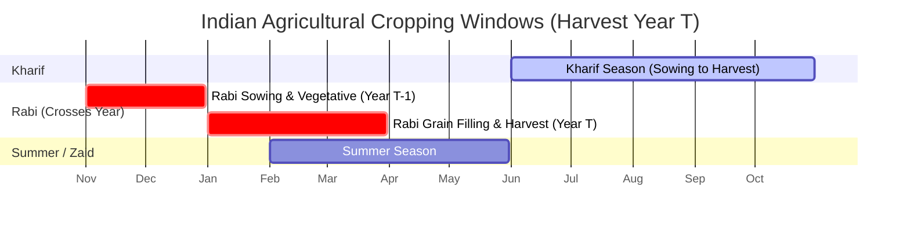

# Universal Multi-Crop and Multi-Region Data Architecture

This document defines the canonical data architecture, registries, schemas, adapter contracts, and quality rules implemented in **Phase 2** for the universal upgrade of the **Crop Yield Prediction Platform**.

---

## 1. Architectural Principles

1. **Strict Provenance & Zero Fabrication**:
   Legitimately unavailable measurements (e.g., pending weather or unprofiled soil) are represented as `None` with explicit missingness flags (`missing_weather`, `missing_soil`). Synthetic interpolation or converting missing values to zero is strictly prohibited.
2. **Leakage Isolation**:
   Post-harvest volumes (`reported_area_ha`, `reported_production_tonnes`) are retained for provenance and data audit purposes only; they are strictly excluded from the predictor feature set.
3. **Explicit Units & Dimensional Standard**:
   All crop yields are normalized to **tonnes per hectare ($t/ha$)**. Source units and raw values are preserved alongside the normalized yield.
4. **Agro-Botanical & Seasonal Separation**:
   Crops and seasons are treated as configurable domain entities rather than hardcoded string constants.

---

## 2. Canonical Observation Schema (`UnifiedCropObservation`)

The standardized observation schema is implemented via Pydantic v2 in [`backend/app/data/unified_schema.py`](file:///c:/Users/adars/OneDrive/Documents/PROJECTS/SMA/backend/app/data/unified_schema.py):

```python
class UnifiedCropObservation(BaseModel):
    # Identification
    observation_id: str                      # Deterministic unique ID (e.g. 'icrisat_akola_soybean_kharif_2015')
    crop_name: str                           # Display title (e.g. 'Soybean', 'Rice (Paddy)')
    crop_id: str                             # Canonical slug registered in CROP_REGISTRY
    crop_category: CropCategory              # cereal | pulse | oilseed | cash_crop | fodder | horticulture | other
    variety: Optional[str]                   # Cultivar or seed variety if reported
    country: str = "India"
    state: str
    district: str
    latitude: Optional[float]
    longitude: Optional[float]
    elevation_m: Optional[float]

    # Temporal & Seasonal
    crop_year: int                           # Harvest calendar year (e.g. 2016)
    season: str                              # Kharif | Rabi | Summer | Whole Year

    # Agricultural Measurements
    yield_t_ha: Optional[float]              # Standardized yield (Target variable)
    yield_unit: str = "t/ha"
    source_yield: Optional[float]            # Raw yield reported in source
    source_yield_unit: Optional[str]         # Raw unit (e.g. 'kg/ha', 'q/ha')
    reported_area_ha: Optional[float]        # Area in hectares
    reported_production_tonnes: Optional[float] # Production in metric tonnes
    is_observed_yield: bool = True           # Distinguishes ground truth from model predictions

    # Multimodal Predictors (Nullable for partial ingestion)
    weather: Optional[WeatherMeasurement]    # Seasonal meteorological indicators
    soil: Optional[SoilMeasurement]          # Topsoil (0-30cm) pedological attributes

    # Data Governance
    source_dataset: str                      # Dataset ID (e.g. 'icrisat_des_dld')
    source_record_id: Optional[str]          # Original table row index
    ingestion_timestamp: datetime
    missingness_flags: List[str]             # e.g. ['missing_weather', 'missing_soil']
    quality_flags: List[str]                 # e.g. ['deduplicated', 'yield_derived_from_production_area']
    validation_warnings: List[str]           # Non-fatal warnings
    quality_score: Optional[float]           # Completeness score [0.0 - 1.0]
```

### Why Specific Fields are Optional
- `weather` & `soil`: Ingested records from statistical bureaus frequently lack contemporaneous meteorological or pedological data until multimodal spatial-temporal alignment takes place. Making them nullable preserves the raw ground-truth agricultural yield records without dropping them prematurely.
- `variety`: Frequently omitted in district-level aggregates where farmers cultivate diverse hybrid/indigenous varieties.
- `latitude` / `longitude`: Preserved as optional for district-level records where a representative rural agricultural centroid is assigned during spatial joins.

---

## 3. Crop Registry (`backend/app/data/crop_registry.py`)

The platform registers 10 core agricultural crops spanning four distinct categories:

| Crop ID | Display Name | Category | Scientific Name | Default Season | Typical Yield ($t/ha$) | Key Source Aliases |
| :--- | :--- | :--- | :--- | :--- | :--- | :--- |
| `soybean` | Soybean | Oilseed | *Glycine max* | Kharif | 0.1 – 4.5 | `SOYABEAN`, `SOYBEAN` |
| `rice` | Rice (Paddy) | Cereal | *Oryza sativa* | Kharif | 0.2 – 8.0 | `RICE`, `PADDY` |
| `wheat` | Wheat | Cereal | *Triticum aestivum* | Rabi | 0.2 – 6.5 | `WHEAT` |
| `cotton` | Cotton | Cash Crop | *Gossypium hirsutum* | Kharif | 0.05 – 3.5 | `COTTON` |
| `maize` | Maize (Corn) | Cereal | *Zea mays* | Kharif | 0.2 – 8.0 | `MAIZE`, `CORN` |
| `chickpea` | Chickpea (Gram) | Pulse | *Cicer arietinum* | Rabi | 0.1 – 3.5 | `CHICKPEA`, `GRAM`, `BENGAL GRAM` |
| `groundnut` | Groundnut (Peanut) | Oilseed | *Arachis hypogaea* | Kharif | 0.1 – 4.0 | `GROUNDNUT`, `PEANUT` |
| `pigeon_pea` | Pigeon Pea (Tur / Arhar) | Pulse | *Cajanus cajan* | Kharif | 0.1 – 3.0 | `PIGEONPEA`, `TUR`, `ARHAR` |
| `sugarcane` | Sugarcane | Cash Crop | *Saccharum officinarum* | Whole Year | 10.0 – 160.0 | `SUGARCANE` |
| `sorghum` | Sorghum (Jowar) | Cereal | *Sorghum bicolor* | Kharif | 0.1 – 4.5 | `SORGHUM`, `KHARIF SORGHUM`, `RABI SORGHUM`, `JOWAR` |

---

## 4. Season Registry & Meteorological Windows (`backend/app/data/season_registry.py`)

Indian agro-climatic zones exhibit distinct seasonal cycles. Crucially, seasons that cross calendar years (e.g. Rabi) are calculated explicitly:



- **Kharif (Monsoon)**: June 1 to October 31 (153 days). Same calendar year as harvest.
- **Rabi (Winter)**: November 1 (harvest_year - 1) to March 31 (harvest_year) (151 days). Crosses the calendar year boundary.
- **Summer (Zaid)**: February 1 to May 31.
- **Whole Year (Sugarcane)**: June 1 (harvest_year - 1) to May 31 (harvest_year) (365 days).

---

## 5. Modular Adapter Contracts

All data source adapters extend [`BaseSourceAdapter`](file:///c:/Users/adars/OneDrive/Documents/PROJECTS/SMA/backend/app/data/adapters/base.py):

```python
class BaseSourceAdapter(ABC):
    @abstractmethod
    def ingest(self, source_path: str, **kwargs) -> Tuple[List[UnifiedCropObservation], AdapterIngestionReport]:
        pass
```

### Implemented Adapters:
1. **`IcrisatDldAdapter`**:
   - Parses the 62,054-row ICRISAT-TCI District Level Database.
   - Maps crop aliases (`SOYABEAN`, `RICE`, `CHICKPEA`, `TUR`, `JOWAR`, `COTTON`).
   - Normalizes units: $\text{Yield (kg/ha)} \times 0.001 \rightarrow t/ha$; $\text{Area (1000 ha)} \times 1000 \rightarrow ha$; $\text{Production (1000 tons)} \times 1000 \rightarrow \text{tonnes}$.
   - Resolves historical district aliases (e.g. `Amarawati` $\rightarrow$ `Amravati`, `Bhir` $\rightarrow$ `Beed`, `Yeotmal` $\rightarrow$ `Yavatmal`).
   - Detects and drops exact duplicate records.
2. **`WeatherAdapter`**:
   - Parses NASA POWER point daily meteorology files.
   - Aggregates weather features dynamically based on season window (`calculate_season_weather_window`).
   - Calculates dry spell streaks ($<2.5\text{ mm}$) and heat-stress days ($\ge 35^\circ\text{C}$).
3. **`SoilAdapter`**:
   - Reads ISRIC SoilGrids 2.0 multi-depth layers (`0-5cm`, `5-15cm`, `15-30cm`).
   - Computes thickness-weighted averages across the 0–30 cm root zone.
   - Converts SoilGrids internal units ($\text{pH} \times 10 \rightarrow \text{pH}$; $\text{dg/kg} \rightarrow \% \text{ wt}$; $\text{cg/cm}^3 \rightarrow g/\text{cm}^3$; $\text{mmol(c)/kg} \rightarrow \text{cmol(+)/kg}$).
   - Normalizes soil texture fractions so clay + sand + silt sum to 100.0%.

---

## 6. How to Add a New Crop or Data Source

### Adding a New Crop:
1. Open [`backend/app/data/crop_registry.py`](file:///c:/Users/adars/OneDrive/Documents/PROJECTS/SMA/backend/app/data/crop_registry.py).
2. Add a new `CropSpecification` entry to `CROP_REGISTRY` with canonical slug, display name, category, scientific name, default season, typical yield range ($t/ha$), and known source aliases.
3. The alias cache and lookup engine will automatically register the new crop across all adapters.

### Adding a New Data Source:
1. Create a new adapter file in `backend/app/data/adapters/` (e.g. `des_dacnet_adapter.py` or `faostat_adapter.py`).
2. Subclass `BaseSourceAdapter` and implement `ingest(self, source_path, **kwargs)`.
3. Use `resolve_crop()` for crop identification and `convert_yield_to_t_ha()` for standardized units.
4. Return the parsed `List[UnifiedCropObservation]` along with an `AdapterIngestionReport`.
